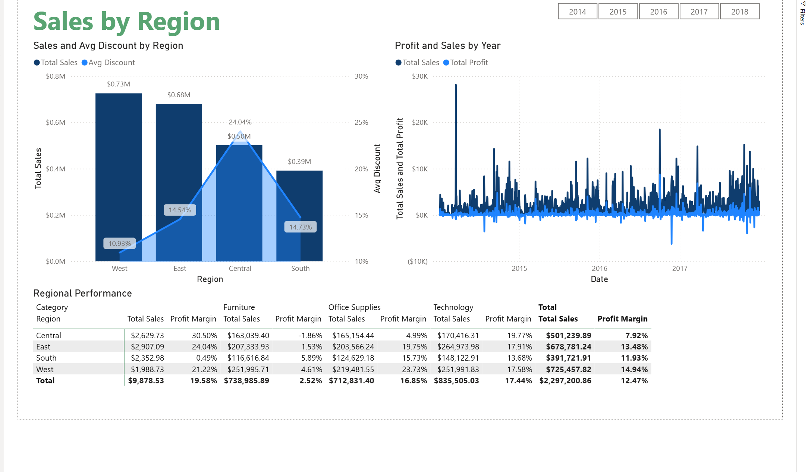
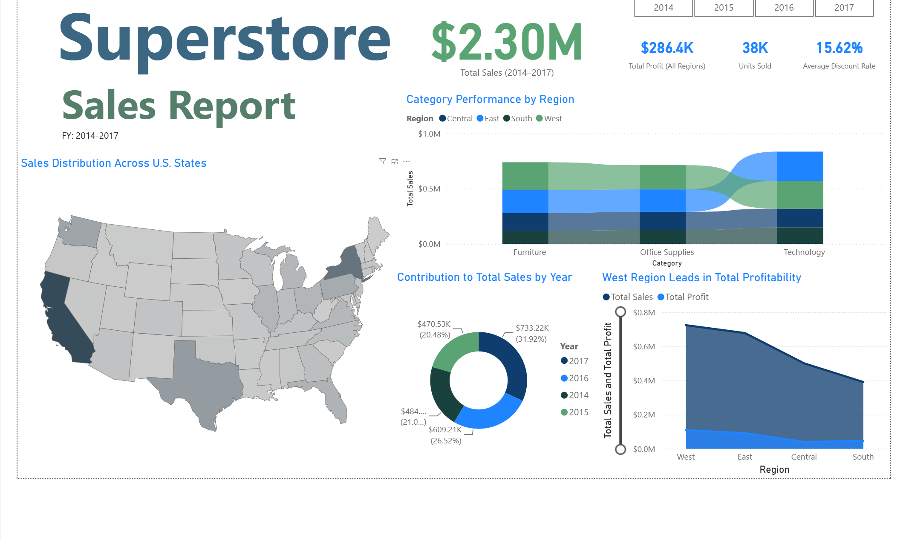
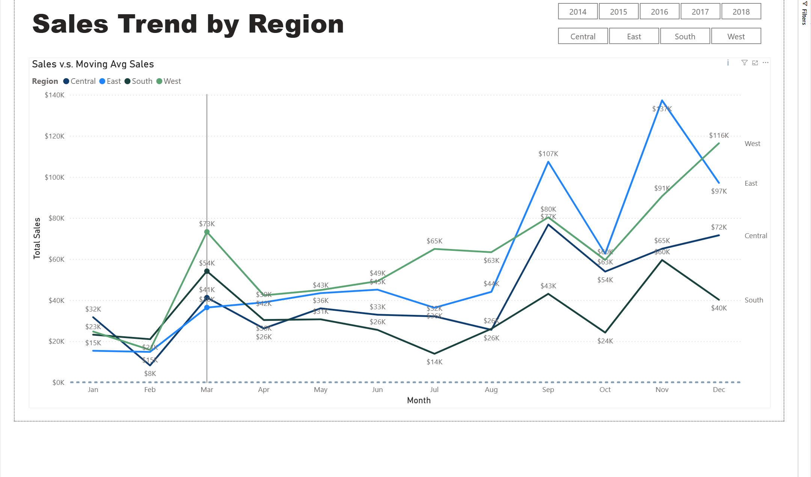
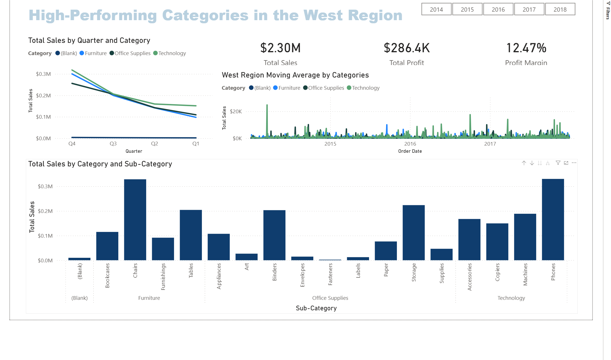

# Retail Sales & Margin Dashboard (Power BI)
### Which regions earn their sales, and where deep discounts come with thin margins

**Troy Dela Rosa** | Independent academic project | Apr 2026

**Data:** Superstore sample retail dataset (Kaggle): 9,994 order lines, 2014 to 2017, four U.S. regions, three product categories.

---

## The business question

A retailer can grow sales by discounting, but discounts come straight out of margin. This report asks:

> **Which regions and categories are earning their sales, and where do the deepest discounts line up with the weakest margins?**

---

## Key findings

**1. The deepest discounts came with the weakest margin.**
Central gave the highest average discount (24%) and earned the lowest profit margin of any region (7.9%). The West gave the lowest average discount (11%) and earned the best margin (14.9%) on the highest sales ($725K).

| Region | Total sales | Average discount | Profit margin |
|---|---:|---:|---:|
| West | $725K | 10.9% | 14.9% |
| East | $679K | 14.5% | 13.5% |
| Central | $501K | 24.0% | 7.9% |
| South | $392K | 14.7% | 11.9% |
| **Total** | **$2.30M** | **15.6%** | **12.5%** |

**2. Furniture sells, but barely makes money.**
Furniture brought in $739K in sales at a 2.5% margin, compared with about 17% for Office Supplies and Technology. In Central, furniture sales lost money (−1.9% margin).

**3. Sales dipped, then grew, with a strong end-of-year peak.**
Annual sales went from $484K (2014) to $471K (2015), then rose to $609K (2016) and $733K (2017). Q4 was the strongest quarter for every category.

---

## What I'd recommend

1. **Review Central's discounting first, starting with furniture.** It has the deepest discounts, the lowest margin, and the only category-region combination that loses money.
2. **Use the West as the benchmark.** It shows that higher sales don't require deeper discounts in this data.
3. **Plan inventory and staffing around Q4,** when sales peak in every category.
4. **Test before changing prices.** These are patterns in historical data, not proof that discounts caused the lower margins. A controlled discount test in one region would confirm it.

---

## The report

| Page | What it answers |
|---|---|
| Dashboard | Overall sales, profit, units and discount; sales by state, year and category |
| Sales by Region | How sales, discount and margin compare across regions and categories |
| Sales Trends | Monthly sales by region with moving averages, filterable by year and region |
| Category Performance | Sales by quarter, category and sub-category |

The report also has a fifth page, Certified Visual, which is not shown here.

<b>More screenshots</b>

 

**Dashboard**

**Sales Trends by Region**

**Category Performance**

---

## How it was built

- **Data model:** transformed the 9,994-row sales file into a star schema in Power Query, splitting, typing and deduplicating customer, product and location dimensions, with a DAX date table.
- **Measures:** DAX measures for sales, profit, margin, distinct orders and year-over-year growth (`SAMEPERIODLASTYEAR`).
- **Report design:** KPI cards, year and region slicers, and chart titles that state the finding.
- **Publishing:** published to Power BI Service.
- **Before the report:** a first look at the same data in Orange Data Mining.

---

## Limitations and known issues

- **Practice dataset.** Superstore is a widely used sample dataset, not a real company's data.
- **Patterns, not causes.** The link between discounts and margin is a correlation across regions and categories.
- **Blank category.** About $9.9K of sales has no category.
- **Year slicer.** Some pages show 2018 although the data ends in 2017.
- **Page title.** The Category Performance page is titled for the West region, but its totals ($2.30M) are for the whole company.
- **Daily chart.** "Profit and Sales by Year" plots daily values, so it is hard to read. Monthly or yearly totals would be clearer.

---

## Tools

Power BI Desktop, Power BI Service, Power Query, DAX, Orange Data Mining (exploration)
